# W3运行准入与共享来源读取集成复查

> 当前范围说明（2026-11-06）：用户已将原 T404/T405 签发加固移出 F118，单列[独立待办](../../../docs/backlog/share-link-issuance-authorization.md)，不再作为本特性依赖或验收前置。当前范围内待办157项，见[范围复核](./scope-review.md)。下文历史任务数及曾记录的签发前置要求保留原时点，由此说明替代；不表示该独立待办已完成。

本波合同先冻结，再由WF/AS/REF并行实施，INT集成、复查及验证。当前248/421项完成，较W2新增82项完成。普通/public WS、v2、节点preview、共用Agent、Info及JWT评测已接实际来源准入；完整F118仍在开发，spec保持94条AC，不扩文件edit、不新增use/任务模型绑定或worker在途外部IO治理。

## 基线、边界与独立复核

W3从d52825f9e5bfd56f40341d59b615993e98e5a79d延续功能分支，共同公共checkpoint53dd9962bcea789533211d8144c95cb209ff73b3后建立三个独立lane。主工作区feat/3.1.0-beta1@ac65c2fc5保持干净，未中途拉取其并发变化，不称远端最新。INT独占公共接口/身份/common/装配/文档；WF/AS/REF各自独占业务叶子。之后INT-EVAL与INT-PROOF按显式转交短暂接独立文件；每卡最多两叶子，红测试和实现分提交，固定SHA交叉复核后正常merge，无cherry-pick/push/deploy。

| 模块 | 固定交付 | 独立复核 |
| --- | --- | --- |
| REF来源scope/Runtime | a8c861eac2、9dccf1ef7 | AS实际核心43项、实际Adapter89项/LGTM |
| WF Owner/facade/WS/v2/node | 9f76d79cf8；57c1b17ef mode跟进 | AS47项/LGTM；root复核非法mode两行修正及18项 |
| AS Owner/Agent/Info | 03ec42355；98a23538e为实际Target测试补充 | WF129项及6subtests/LGTM；root核后续无source变化 |
| R2原对象proof补核 | 87180449242 | AS35项及完整/子集/混批额外probe，LGTM |
| JWT评测 | 6de5acd2e43 | AS33项/LGTM；作者完整新旧41项 |
| INT common/真实装配 | c18c01b0a、449ee813d | REF固定079218780复核，7路径40项/LGTM |

各lane的通过数为其固定快照结果，不相加。作者日志与实际根组合验证不同；一次性probe不作为已提交覆盖。最终业务代码测试SHA与后续文档提交分开记录。

最终文档由AS agent独立复核/LGTM：完成增量校正为82，保存来源与临时预览流程分支明确；设计、合同、升级、入口、任务和HTML一致，未将剩余来源、签发授权或真实环境验收误标完成。文档修订后受测源码保持不变。

## 实际执行协议

```mermaid
flowchart TD
  A[原身份与可信业务ID] --> B{已保存运行或临时预览}
  B --> S[保存来源Owner授权及精确索引候选]
  S --> T[全部保存目标按锁序当前读]
  T --> U[真实root版本links当前读并重授权]
  U --> V[guard source raw及完整配置重验]
  V --> W[不可变来源快照]
  B --> P[原root edit候选授权及临时输入]
  P --> Q[完整临时目标当前读及可见准入]
  Q --> R[真实root edit current及canonical输入重验]
  R --> N[临时已核输入 不读或要求来源索引]
  W --> H[会话 Redis queue 或模型调用]
  N --> H
```

scope由Verifier私有发行，绑定原对象/Session事务/原identity完整fingerprint/用途/nonce/实际SourceOwnerTenant；只在实际全部TargetOwner完成核验后允许root重验。所有目标/index/legacy窄读是列投影，不污染其他租户ORM identity map，不切ContextTenant或actor。模型共享只用真实relation/默认继承；读取结果不成为R2绑定写资格，临时图不读取或要求source/index/coverage/legacy、不建来源；其完整目标之后只重验真实root/edit/current及canonical输入。

保存链与临时链在上图分开；缺来源索引仍可经合法edit和完整目标准入运行preview，但不能借此绕过saved来源回填。WF只normalize完整nodes/edges，保存图匹配完整事实而非只比refs；public不preview，普通preview保edit。v2 override在真实保存图深拷贝上应用，改引用拒；两个WS端点绑定Port，common先准入再创建会话/写Redis/入队。check_status及其他消息也不能用flow_id切换连接根，10994/10996/10998保原业务码。原各channel ONLINE条件保持。

AS Agent每次init/run/stream和缓存复用核实际当前snapshot；publish与业务保存共用事务，初次失败不缓存半初始化对象，配置变化清缓存供手动修复后重建。Info保全knowledge_ids/reference_states，knowledge_list只真实可展示条目，未知状态None与空列表分开；写成功后不因补inspect伪报失败。WORKBENCH_CHAT token核真实MessageSession而非meta，来源候选仍按原C3视图；T404/T405签发ACL未闭合，发行前必须处理。

评测真实JWT web_session引用核原user/homeTenant/tokenVersion，管理pin独立；调度和任务入口严格核实际evaluation owner/currenttenant，各题重新准入存储的正version，再把实际graph送线程/Redis。AS沿共用Agent每次guard；不冒充creator或新增任务模型关系。

## 主agent组合验证

受测源码：`0c2587dbe5ec93135e06a45ed7615253a6a46ef1`；1199 passed、6 subtests passed（46个pytest路径），无fail/skip。日志`/private/tmp/f118-wave3-integrated-tests.log`，完整路径与退出码见同名json。包含完整F118、历史权限/WF/AS、OpenAPI执行身份、public会话/WS兼容及evaluation目录，父目录下测试不会再重复选择。W1的424、W2的821及各lane结果均为历史快照，不累计。

静态：70个W3改动Python文件Ruff检查及format --check通过；arch-guard按诊断文本核对冻结基线，新增违规0。三个legacy common文件原有6条RULE-1 VIOLATION以及2条原有RULE-3 WARNING明确保留为既有债务，同时AST核新增受禁反向imports为0；不把脚本exit0等同架构全零。结果`/private/tmp/f118-wave3-static.json`。全提交和工作diff-check、任务DAG/完成依赖/两叶子、94AC索引及HTML13SVG/ID/锚点/链接验证单列。

组合测试仅复用既有Python3.11.13 venv和只读配置路径，PYTHONPATH指向功能源码。SQLite事务/SQLModel真实C3 listener与FOR UPDATE调用/SQL形状不等于真实MySQL/DM8锁调度；权限/共享/队列依赖在Port使用double。API/worker helper隔离验证实际装配调用图，未启动真实服务。

## 红绿及等价fixture记录

| 卡 / 问题 | 实际证据 |
| --- | --- |
| T346→T344、T348→T345 | 缺module红，DTO8与access2绿；身份T350→T347后组合21绿 |
| WF T353→T354、T041→T042、T355→T356、T357→T358、T359→T360 | Owner/消费者/node/WS/v2分卡红绿；完整提交见各卡和git历史 |
| T392→T393、T397→T398、T399→T400、T406→T407 | KG类型锁后读、真实Core临时原文、候选后软删归类、非法mode均实际复现后修复 |
| AS T362→T363、T364→T365、T366→T283、T367→T368、T369→T370、T294→T295 | Owner/facade/共用Agent/publish/cache/Info分卡红绿；后续真实Target适配测试独立补充 |
| T395→T396、T401→T402 | 真实分享会话事实及首次失败缓存问题红绿；不以metadata或初次未完成Agent缓存放行 |
| REF T371→T372、T373→T374、T375→T376/T377、T378→T379、T380→T381 | 实际私有scope、窄索引、业务Target与冻结legacy证据；错误/目标计划与最终root当前读集成 |
| T409→T410、T411→T412 | 重载eq/hash克隆实际原scope/receipt复现，私有weakref原对象is核验；不变授权DTO/锁序 |
| T382→T383、T386→T387 | common7红→绿、装配module缺失红→实际4绿；T414类型Port无业务IO |
| T417→T418 | 6d3c6e6b1两个状态切root红（2fail7pass）→449ee813d九绿，原client状态不变/零会话Redis副作用 |
| T384→T385、T415→T416 | 17红→17绿后真实get_login_user web_session3正例再红，6de5修复；新旧evaluation41绿 |
| T394/T403/T408/T413 | 老测试改用新真实入口/原UserPayload，保原线程/ON-OFF/保存/进度断言，不重引退休DAO |
| T419/T421 | 原组合暴露旧fixture：4d49同legacy缺Context、旧auto-rerun配置stub缺open_api；固定旧基线亦失败。只补真实tenant_context(101)/既有配置字段，不绕过C3、不改产品源码；补既有wire键并保持strict等式及原行为断言 |

## Task Review L1与剩余范围

按已读`.claude/skills/task-review/SKILL.md`七项清单及当前constitution/最近AGENTS：新SourceOwner/Repository/Verifier位于相应domain/application模块；native async与显式外部Session保持；DTO不外泄身份凭据/evidence/tenant。common只新增Protocol依赖，legacy反向import基线债务已明列。前端仅ChatPane两个可选提示字段，TS语法及基线ESLint增量检查通过，未宣称完整前端build。设计/合同/升级/HTML与任务状态对齐，结构元数据为421唯一卡、完成248卡、94AC测试索引、每卡1–2叶子及DAG/完成依赖验证。

本波任务增加82项完成，T041/T042/T283/T294/T295已完成；完整F118仍有173项未完成，包括T404/T405分享签发ACL、其他四类来源写端、Coverage实际适配/正式回填、目标删除协调、处理worker、两端页面、迁移演练和全特性L2/E2E。下一波按这些前置关系继续，不以Reader存在或无引用行自动ready。

未运行真实MySQL/DM8/OpenFGA/Redis-Celery/ES-Milvus/模型服务、浏览器E2E、CI、停服/迁移或部署。正式升级仍先停服及一致备份，再盘点/冻结全平台权限与引用基线；脚本不负责探测停服。本轮没有push或修改主工作区。
