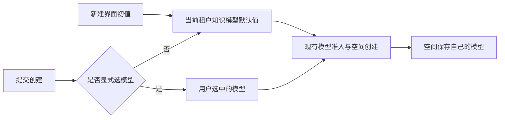

# Design: 知识模型配置收敛与旧溯源只读兼容

**关联**：[已确认规格](./spec.md) · [需求发现](./discovery.md)
**版本**：v3.1.0 / F002
**最后更新**：2026-11-27
**状态**：设计审查通过且用户已确认（2026-11-27）；本地实现及验证完成，真实部署验收待执行。实现与限制见 [verification.md](./verification.md)。
**代码基线**：`49dde8a70d79407c459bdd0d7651754bc9d37002`，独立分支 `codex/knowledge-model-config-20261127`。

## 1. 目标与非目标

将新建知识空间的默认 embedding 统一到知识模型配置，移除工作台 embedding 及旧溯源生成模型设置。新消息使用现有引用标记溯源，历史消息继续通过原按钮和数据查看旧溯源。

本次不批量更换已有空间模型、不重建索引、不转换或清理历史会话、不删除旧溯源读取功能，不调整 QA、计费或授权规则。

## 2. 关键约束

- 遵循 [constitution.md](../../../docs/constitution.md) C1–C8；本次不修改这些规则。沿用原模型配置与知识空间业务入口，不新增 ORM 查询、权限检查路径或授权模型。
- 遵循 [v3.1.0 版本契约](../release-contract.md) 及其继承的 F006 引用提示合同：引用为异步辅助提示，不能新增同步强一致或升级覆盖准入门槛；保留真实空间模型引用。
- 历史 `ChatMessage.source == 1` 是旧文件溯源按钮的显示依据；历史关键词和段落位置信息保存在 `RecallChunk` 中。兼容读取不能依赖被移除的模型配置。
- 新消息的引用数据由 Citation Registry 维护，不能因停止旧关键词任务而取消引用收集、持久化、注册校验或来源文件权限校验。
- 不新增表、列、迁移脚本、第三方依赖或本地共享状态；数据库仍兼容 MySQL / DM8。
- 默认配置按当前租户解析，继承 Root 与实际模型共享是不同约束；沿用现有解析与模型准入，不能因默认值来源改变而放宽任何一项。

## 3. 方案对比与选定

### 决策 1：替换默认值来源，保持空间创建与显式选择协议

- **备选**：只改界面默认值；将历史工作台 embedding 回填为知识默认值；直接将所有创建消费者切换为知识配置。
- **选定**：新建初值和未显式指定模型时的服务端默认值均读取 `knowledge_llm.embedding_model_id`，显式模型选择继续优先。历史工作台值直接退出使用，不自动复制。
- **原因**：基线 `creation_settings.py` 与 `create_knowledge_space` 均仍读取工作台值，只改其中一处会导致界面和创建结果分裂。两项历史默认值可能不同，自动复制会覆盖管理员已有知识模型选择。
- **何时重新考虑**：产品引入多个命名的空间创建模板，并明确要求模板独立默认模型时。

### 决策 2：保留旧数据读取，停止生成与新消息旧标识

- **备选**：删除全部旧入口；只删除模型设置并继续用 jieba；仅停止写关键词但继续给新消息设置旧按钮标识。
- **选定**：删除关键词生成调用及其专用辅助函数；新文件问答使用 `source=0`，保留新引用数据；历史 `source=1` 和 `RecallChunk` 不变。旧按钮、弹窗、独立页面和读取接口保持。
- **原因**：用户明确要求已有旧按钮仍然可用。旧读取只依赖已保存数据，移除生成模型不妨碍读取；只去掉模型会继续执行分词回退，只停任务会给新消息留下无法使用的旧按钮。
- **何时重新考虑**：用户明确另行授权退出历史旧溯源，或者提出有依据的历史引用转换需求时。

### 决策 3：移除配置字段和有效槽位，兼容历史 JSON 输入

- **备选**：仅隐藏控件；长期保留字段但设为空；移除字段并清理其有效槽位注册。
- **选定**：删除 `WorkbenchModelConfig.embedding_model`、`KnowledgeLLMConfig.source_model_id` 及其自动补齐、引用提取和诊断注册。沿用配置模型当前对未知字段的忽略行为，旧 JSON 可读取、旧页面提交多余字段可接收，但这些值不再执行或计入有效来源。
- **原因**：只隐藏控件会留下错误的模型使用提示，还可能阻断其他仍有效配置的执行。无需改写全租户配置表；正常保存时只持久化现行字段即可。
- **何时重新考虑**：统一配置层改为严格拒绝未知字段时，需要在配置 Owner 提供相应版本兼容，不在本功能引入另一套模型解析。

### 决策 4：授权对象选择不依赖默认 embedding

- **备选**：把 `_prospective_creation_access` 的默认 embedding 前置检查直接换成知识配置；将模型检查放在最终创建阶段。
- **选定**：授权对象查询保留配额和实际身份检查，移除其 embedding 必填检查；最终创建校验本次实际选择的模型。未显式选择时读取知识默认槽位。
- **原因**：该授权查询没有用户本次模型参数，无法判断显式选择；以默认配置缺失阻止它，会导致用户已经选择可用模型却不能完成创建授权配置。它也不应校验与创建无关的 QA / 摘要等槽位。
- **何时重新考虑**：授权对象查询本身需要根据实际选中模型限制候选主体，并新增了明确业务合同及参数时。

## 4. 系统现状

### 4.1 当前实现

1. `creation_settings.py` 从 `knowledge_llm.embedding_model_id` 窄投影初值，`KnowledgeLibraryDialog` 保持原响应协议。展示读取保留非法的历史标量 ID 供修复，不解析无关配置；对象/布尔值不投影，避免泄露或误转成模型 1。
2. `KnowledgeSpaceService.create_knowledge_space` 在缺少显式选择时读取知识默认单槽位，将最终模型保存在空间；授权对象查询仅保留配额与主体检查。既有创建幂等路径保持。
3. `ModelDefaultApplication.asave` 直接返回 typed config，原 embedding 变更标记包装、工作台模型探测和重建确认已删除；保存权限、事务与引用辅助同步保留。
4. `RedisCallback.save_chat_message` 在落库和发送前将新文件回复的旧 source 标识设为 0，继续注册和保存新引用。普通输出、流式结束、带选择和输入的输出复用它；旧关键词任务与生成函数已删除。
5. 无调用方的工作台旧 `final_message` 已移除；其文件中其他仍被使用的序列化和 SSE 辅助函数保留。
6. 历史旧按钮、弹窗、独立页面、`QaRecallService`、`QaRecallRepository` 和 `RecallChunk` 保持；读取原记录且不依赖生成模型配置。QA 相似问、旧链接/QA 来源类型和新引用逻辑保持。

### 4.2 默认模型数据流

- 初值：继续先执行 `KnowledgeCreationPolicy.prepare`，通过 `ModelDefaultReadRuntime.aget_default("knowledge_llm")` 做配置展示读取。只投影默认 embedding，不因无关配置失效而阻断新建弹窗。
- 保持初值响应 `{embedding_model, system_defaults}`。`embedding_model` 为空或 `{id: str, name: str}`；ID 来自知识默认值，名称由前端既有模型候选列表解析，投影无已存名称时使用空串，不为此新增模型访问面或暴露服务凭证。
- 最终创建：在未提供 `embedding_model_id` 且不存在幂等创建结果时，调用 `LLMService.aget_knowledge_llm(slots=("embedding_model_id",))`。沿用单槽位执行准入，再将最终模型交给现有空间创建与模型引用流程。显式选择继续走同一创建准入。
- 默认缺失使用现有 `KnowledgeNoEmbeddingError`（10901），相关三语说明指向知识模型默认值或创建时选择；模型失效继续使用现有模型错误。旧 `WorkbenchEmbeddingError` 不再由这些创建路径产生，不复用其编号。
- `legacy_documents.py` 适配器同步去掉对工作台 embedding 错误的转换，使用知识模块既有错误；开放 API 原有知识默认行为保持。
- `_prospective_creation_access` 仅保留其现有授权对象查询职责，不读取任何默认模型；配额、主体及权限规则不变。
- 既有空间的查询、检索、重建仍从空间自身模型读值。本次不修改其模型、索引代际、处理中状态或幂等协议。

### 4.3 新消息与历史消息

新消息：来源文档 → 保留来源类型判断和新引用注册 → 旧文件来源类型从 `FILE(1)` 映射为 `NOT_SUPPORT(0)` → 保存消息与 Citation Registry → 发送相同对象。

- 只抑制新文件关键词溯源标识，保留 QA(4)、链接(3)、无权限(2) 等原有展示语义，不整体删除 `SourceEntry` 或来源类型枚举。
- 在共同的消息保存方法中同时确定落库和流式结束响应的 `source`，避免实时不显示但历史回放又出现旧按钮。无 `chat_id` 的调试路径继续保留当前引用注册与伪消息 ID 行为。
- 已删除关键词任务提交、同步/异步生成函数、提取关键词 prompt、相关导出与 `get_knowledge_source_llm*`。无调用方的工作台旧 `final_message` 一并删除。
- 新路径不调用溯源模型或 jieba，不再写 `RecallChunk`。不通过全局禁用 LLM 或修改分词库实现，避免影响 QA 相似问等其他场景。

历史消息：现有 `source=1` → 原 `SourceEntry` / 会话日志按钮 / 独立来源页面 → 原关键词与段落读取 → 原关键词调整、来源排序和文件预览。

- 保留 `QaRecallService`、`QaRecallRepository`、`RecallChunk` 数据结构以及三种旧入口。
- 历史读取不调用生成模型；缺失记录或文件沿用当前不可用处理，不补生成。
- 历史会话身份校验、审计范围、来源文件下载权限和租户可见性继续由原服务执行，不改变校验顺序或扩大可见范围。

### 4.4 模块职责与改动边界

| 模块 / 文件 | 本次职责 | 保持的边界 |
| --- | --- | --- |
| `llm/domain/schemas.py` | 删除两个退役配置字段，更新知识模型描述 | 不修改其他配置值和模型类型 |
| `llm/application/model_default.py`、`llm/domain/services/llm.py` | 移除 embedding 变更检测与探测结果包装的专用部分、溯源生成 getter | 保留配置保存权限、事务、聊天默认模型成员校验及提交后的引用同步 |
| `default_reference_extractor.py`、`system_model_autofill.py` | 停止提取或补齐两个退役槽位 | 保留知识 embedding、摘要、QA、ASR 和其他工作台模型槽位 |
| `knowledge/application/creation_settings.py`、`knowledge_space_service.py` | 切换默认来源并修正授权对象查询的模型耦合 | 不新增直接 DB 查询，不修改空间授权、配额与幂等 |
| `worker/workflow/redis_callback.py`、`common/chat/utils.py`、`common/chat/__init__.py`、`workstation/.../chat_helpers.py` | 删除旧生成依赖、抑制新旧式文件标识 | 保留新引用与来源类型中 QA / 链接等展示能力 |
| `KnowledgeModel.tsx`、`WorkbenchModel.tsx` 及其校验辅助 | 删除选择器、表单字段、校验和重建确认；添加默认模型提示 | 保留其他设置、提示词单独保存和保存失败处理 |
| 三语 `model.json`、共享错误码文案 | 栏目及本功能提示同步调整 | 不手改生成的错误码文案文件、不做全站替换 |
| 历史旧溯源前后端 | 兼容回归验证 | 保留按钮、路由、API、查询和历史数据 |

引用展示和诊断通过同一个有效槽位提取器收敛；`model_default_source_owner`、`system_model_settings`、来源同步按现有机制调用它，不添加独立硬编码的退役列表。反向提示中可能已有旧槽位条目，沿用现有来源重算与异步同步刷新，不新增全租户配置回填或升级门槛；提示允许现有合同规定的延迟。模型的其他真实来源继续有效。

### 4.5 文案与界面

沿用已有组件和布局，仅移除设置并调整提示，不新增组件、样式或状态管理。

| 位置 | 中文文案方向 | 核实依据 |
| --- | --- | --- |
| 栏目 | 知识模型 | 用户已确认 |
| 默认 embedding | 默认 embedding 模型；新建知识空间默认使用，可在创建时另选。修改默认值不会更换已有空间模型或触发重建 | 创建流程及 AC-02–05 |
| 摘要/标签模型 | 用于知识空间文件的摘要和自动标签生成，是否执行分别由对应开关及空间标签设置控制 | `KnowledgeUtils.get_knowledge_abstract_llm`、`KnowledgeSpaceAutoTagService` |
| 摘要提示词 | 知识空间文件摘要提示词；为文件生成摘要时使用 | `AbstractTransformer` 将摘要写入文件及段落 metadata，不能再称仅生成标题 |
| ASR | 用于知识空间音视频文件解析中的语音转文字 | `MediaTranscriptionService` |
| QA 相似问 | 保留 QA 知识库相似问模型及其用途说明 | 既有 QA 功能 |

英文、日文保持相同含义。删除仅服务已移除控件的重建提示和溯源模型名称；保留历史旧弹窗使用的溯源、关键词、来源文件等文案。

## 5. 已知坑 / 反直觉事实

| # | 已核实事实 | 忽略后的后果 | 处理位置 |
| --- | --- | --- | --- |
| 1 | 前端仍提示修改工作台 embedding 会全量重建，当前后端已无该派发 | 错把旧提示当作最新行为，或重复引入已删除逻辑 | `WorkbenchModel.tsx`、`LLMService._save_model_default` |
| 2 | 后端旧关键词任务仍有调用，但新引用预览不消费关键词 | 仅凭调用存在而保留无用生成和配置 | `RedisCallback.save_chat_message` |
| 3 | 只停止写 `RecallChunk` 仍可能给新消息保留 `source=1` | 新按钮打开空弹窗或持续加载 | 同一保存方法在落库及发送前确定新 `source` |
| 4 | 历史旧读取独立于生成模型 | 误删旧按钮/API，会破坏用户明确要求保留的历史功能 | `qa.py`、`QaRecallService`、`ResouceModal`、原来源路由 |
| 5 | 创建默认值与授权对象查询当前都读工作台配置 | 只改弹窗仍用错默认值，或显式选择仍被空默认值拦住 | `creation_settings.py`、`create_knowledge_space`、`_prospective_creation_access` |
| 6 | 配置展示读取与执行准入不同；单槽位可避开无关失效值 | 因 QA / 摘要配置失效无法创建，或初值读取暴露凭证 | 原 `ModelDefaultReadRuntime` 展示与执行接口 |
| 7 | 提示词有单独保存入口，旧表单快照也可能带退役字段 | 普通保存已清理，单独保存又带回旧配置 | `KnowledgeModel.tsx` 载入、整表保存、单提示词保存统一移除 |
| 8 | 引用提示为异步辅助能力，历史索引可能滞后 | 为清理两个槽位引入全表回填或同步阻断 | 复用共享提取器和既有 source sync，不改引用底座 |

## 6. 对外契约与依赖

### 6.1 提供给消费者的契约

| 契约 | 本次行为 | 消费者及兼容性 |
| --- | --- | --- |
| `/api/v1/knowledge/space/creation-settings` GET | 响应字段不变，默认值来源改为知识模型 | `KnowledgeLibraryDialog`；ID 继续投影为字符串，名称为空时由现有模型选项显示 |
| `/api/v1/knowledge/space` POST 及现有兼容创建入口 | 显式 ID 优先，否则读知识默认值 | platform、兼容入口、开放 API；不增请求参数 |
| 系统模型配置已有读取/保存接口 | 不再提供或有效保存工作台 embedding、溯源模型字段 | 老 JSON 输入的多余字段忽略；其余模型与租户权限合同不变 |
| `LLMService.aget_knowledge_llm` | 复用 `slots=("embedding_model_id",)` 读取 | 新建空间；QA、摘要、媒体及记忆等原有消费者保持其既有用途 |
| `/api/v1/qa/keyword` GET、`/api/v1/qa/chunk` POST | 保持历史读取响应、权限与签名逻辑 | 历史旧按钮与独立来源页；不重新生成数据 |
| `ChatMessage.source` / 结束事件 `source` | 新文件消息不再赋值 1；历史数据不改 | platform 旧按钮；QA / 链接来源语义保持 |
| Citation Registry 与 `/api/v1/citations/**` | 保持现有保存、解析、权限过滤和预览 | 新消息和历史已注册引用 |

删除的生成辅助函数仅有本功能已定位调用方；实现时再次搜索全部调用/导出并同步测试，不为已废弃生成行为另加兼容包装。

### 6.2 依赖与风险

| 依赖 | 用途 | 变化风险 |
| --- | --- | --- |
| `ModelDefaultReadRuntime`、配置 Repository | 租户有效默认值与修复展示 | 展示/执行 API 混用会使无关配置阻断创建 |
| `KnowledgeCreationPolicy`、原空间模型准入及权限服务 | 创建身份、配额、模型共享与业务权限 | 不得因删默认模型检查而删配额或主体检查 |
| 原来源类型及消息保存顺序 | 新旧按钮区分 | 保存前后分别修改 source 会使流式与历史不一致 |
| 原旧消息父级与 `RecallChunk` 关联 | 历史读取 | 移除表或批量改消息会使旧功能不可用 |
| MinIO / 原文件签名及预览 | 新旧来源文件查看 | 文件不存在仍按现有失效处理，不保证复原已删内容 |
| 既有 SQL、Redis、ES / Milvus、OpenFGA 环境 | 集成与验收 | 本地无中间件时只能证明被执行的局部检查，不代表真实环境验收 |

本功能不新增系统二进制、外部服务或运行参数。不新增错误码；缺失 embedding 沿用 10901，其他模型及权限错误沿用所属模块合同。旧 10810 编号不分配给其他错误。

## 7. 测试与可观测

- **默认值及配置**：扩展 `test_kn_creation_settings`、`test_kn_creation`、`test_workbench_reference_atomicity`、默认槽位/提取/消费者及自动补齐测试。构造知识默认 A、历史工作台 B，证明初值和默认创建选择 A，明确选择 C 则用 C。缺失、下线、跨租户未共享与显式合法选择分别验证。
- **新消息**：工作流 callback 回归覆盖普通输出、流式结束、选择和输入输出；新引用仍持久化，消息与事件无旧文件按钮标识，无旧任务、溯源模型调用或 `RecallChunk` 写入。
- **历史兼容**：沿用 `test_qa_recall_repository`、`test_qa_recall_authorization`、`ResouceModal` 现有用例，加入移除模型配置后仍读取历史记录的组合场景；保留未授权拒绝与来源文件遮蔽行为。
- **前端**：针对工作台与知识模型表单回归无退役控件、无必填阻断、无重建弹窗、提示词单独保存不带旧值；历史 `source=1` 仍有旧按钮，新消息仍有引用预览。
- **静态检查**：按改动文件运行 ruff 与 arch-guard；前端运行 `pnpm lint`、`pnpm typecheck`、`pnpm check-i18n`。测试失败须以相同选择的基线判断新增回归，不修无关问题。
- **E2E**：按仓库 `/e2e-test` 执行本功能端到端验证；未具备环境或账号时记录未执行项，不能将 mock 验证称为环境验收。
- **人工验证入口**：platform 本地 `:3001` 的模型管理 → 系统模型配置，以及知识空间新建弹窗；工作流编辑器调试消息和会话日志旧按钮。启动使用现有 `src/frontend/platform` 的 `pnpm start -- --host 0.0.0.0`；后端使用 `src/backend` 的 `uv run uvicorn bisheng.main:app --host 0.0.0.0 --port 7860 --workers 1 --no-access-log`，配置与中间件按开发环境提供。
- **账号/数据**：管理员用于设置默认值；普通成员用于创建与历史读取；另一个无权用户用于拒绝验证；有原 `source=1` 且完整旧段落数据的历史消息，以及具有新引用的问答样本。测试环境地址、账号、具体历史消息 ID 尚未提供，QA 参考用例已标明准备方式和待执行状态。
- **观察**：对比创建返回及空间保存的模型、原索引与状态；监测本次保存不发起重建任务；对比新消息旧记录写入与任务提交为零、新引用数及旧接口读取结果。无需新增日志系统或后台定时器。

## 8. 后续改进 / 不打算做的事

- 历史旧机制保留读取，其 UI 与数据格式不统一到新引用，因为用户明确选择继续兼容；不新增历史转换任务。
- 历史数据本身缺失、来源文件已删除等问题保持现有处理，不以模型补造来源。
- 不主动批量清理历史配置 JSON 或引用辅助索引；有效槽位退出使用，引用按原异步合同刷新。
- 不引入新旧切换开关、数据库新字段或按升级时间猜测消息版本。
- 不修改知识默认 embedding 的其他既有消费者，例如 QA 和记忆索引；提示仅描述其对知识空间的作用，不承诺对全系统其他功能无影响。

## 修订历史

| 日期 | 改动 | 触发原因 |
| --- | --- | --- |
| 2026-11-27 | 设计初稿：统一知识默认、退役生成配置、新消息停止旧生成并保留历史读取 | 用户已确认规格及历史兼容要求；待设计确认，尚未实施 |
| 2026-11-27 | 按确认设计完成实现；新增窄投影与畸形旧默认值保护、新旧消息兼容回归，记录基线失败和环境验收边界 | 本地验证与代码审查 |
